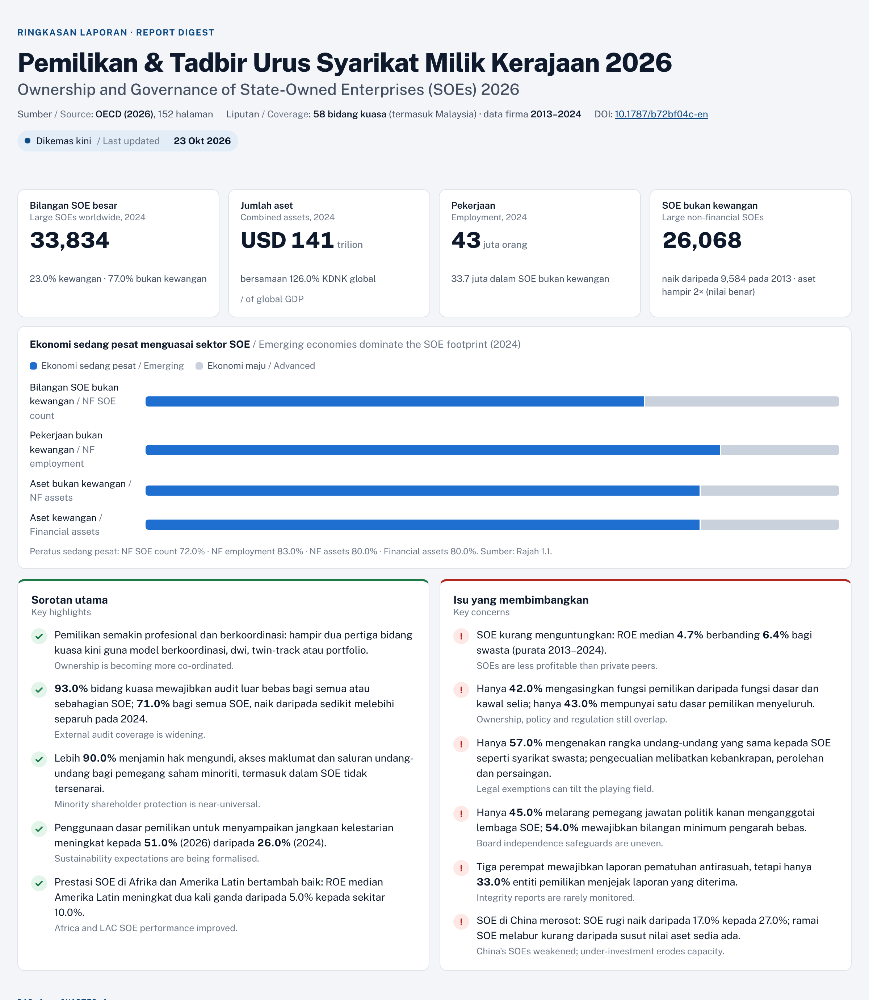

# OECD SOE Governance 2026 dashboard

A bilingual (BM/EN) dashboard summarising OECD findings on state-owned enterprise (SOE) governance, with a Malaysia section (context, findings, way forward). Plus the social media scripts written from it.

## What's inside

| Path | What it is |
|---|---|
| `soe-dashboard.html` | "SOE Governance 2026 Digest", a full single-page dashboard. Open it in a browser. |
| `soe-dashboard-animated-page.html` | Animated tabbed version |
| `content/` | LinkedIn post, Threads thread, TikTok scripts (60s and 2 min), alternate hooks and captions |

## How to use

No build step. Open the `.html` files in a browser (internet needed for chart libraries).

> Note: some `.html` files here are page fragments made for Claude dashboard artifacts (they start with `<style>`, not `<!doctype html>`). They use the host page's fonts and colours, so they look plainer when opened straight in a browser.

## Source

OECD publications on SOE governance (2025, 2026), as cited on the dashboard. Figures belong to the OECD.
